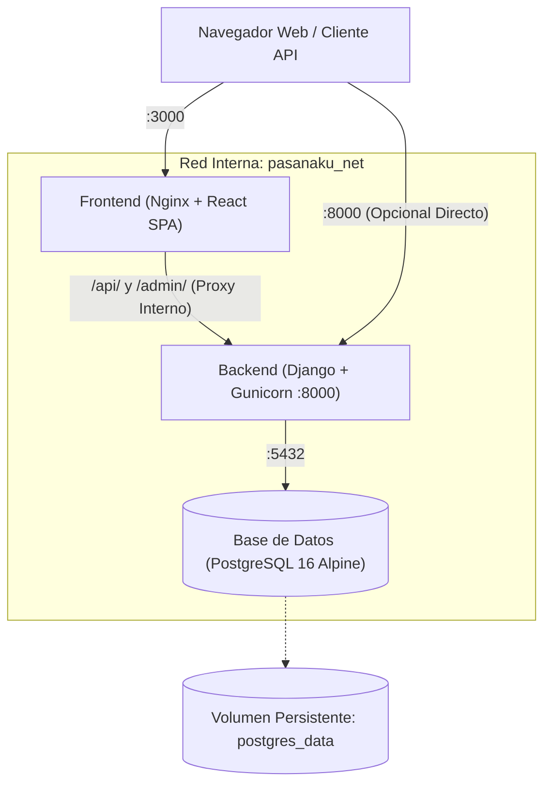

# 🐳 Guía de Despliegue con Docker — Pasanaku Digital

Guía completa para construir, levantar y administrar el ecosistema completo de **Pasanaku Digital** (Frontend React, Backend Django y Base de Datos PostgreSQL) mediante **Docker** y **Docker Compose**.

---

## 🏗️ 1. Arquitectura de Contenedores

El despliegue orquesta tres servicios interconectados a través de una red interna aislada (`pasanaku_net`):



| Servicio | Imagen / Build | Puerto Externo | Función |
|---|---|:---:|---|
| **`frontend`** | Multi-stage (`node:20` $\rightarrow$ `nginx:alpine`) | `3000` | Sirve la SPA y actúa como reverse proxy hacia `/api/` y `/admin/` |
| **`backend`** | `python:3.12-slim` + Gunicorn | `8000` | API REST Django, migraciones automáticas y recolección de estáticos |
| **`db`** | `postgres:16-alpine` | `5432` | Base de datos relacional con comprobación de salud (`healthcheck`) |

---

## 📋 2. Requisitos Previos

- **Docker Desktop** (en Windows/macOS) o **Docker Engine** + **Docker Compose v2** (en Linux).
- Verificar que el motor de Docker esté en ejecución:
  ```bash
  docker --version
  docker compose version
  ```

---

## 🚀 3. Puesta en Marcha Rápida (1 solo comando)

1. **Configurar el archivo de entorno (Opcional):**
   Si deseas personalizar contraseñas o puertos, copia la plantilla:
   ```bash
   cp .env.example .env
   ```
   *(Si no se crea `.env`, Docker Compose utilizará los valores por defecto seguros preconfigurados).*

2. **Construir y levantar los contenedores:**
   ```bash
   docker compose up --build
   ```
   *Para ejecutar en segundo plano (modo daemon):*
   ```bash
   docker compose up --build -d
   ```

3. **Verificación de servicios en ejecución:**
   ```bash
   docker compose ps
   ```

---

## 🌐 4. Acceso a las Aplicaciones

Una vez iniciados los contenedores:

- **Frontend (Aplicación Web React):**  
  👉 [http://localhost:3000](http://localhost:3000)
- **Backend (API REST Pasanaku):**  
  👉 [http://localhost:8000/api/v1/](http://localhost:8000/api/v1/)
- **Panel de Administración de Django:**  
  👉 [http://localhost:8000/admin/](http://localhost:8000/admin/)  
  *(o también a través del proxy en [http://localhost:3000/admin/](http://localhost:3000/admin/))*

---

## 🛠️ 5. Comandos Útiles de Administración

### 5.1. Crear un Superusuario (Administrador de Django)
Para acceder al panel `/admin/`:
```bash
docker compose exec backend python manage.py createsuperuser
```

### 5.2. Ejecutar la Suite Completa de Tests dentro de Docker
Puedes verificar que los 44 tests pasen contra la base de datos PostgreSQL real del contenedor:
```bash
docker compose exec backend pytest -v --tb=short
```

### 5.3. Ver logs en tiempo real
```bash
# Todos los servicios:
docker compose logs -f

# Solo el backend:
docker compose logs -f backend

# Solo el frontend:
docker compose logs -f frontend
```

### 5.4. Detener y reiniciar los servicios
```bash
# Detener los contenedores (conservando los datos de la base de datos):
docker compose down

# Detener los contenedores y eliminar volúmenes (reseteo total):
docker compose down -v
```

---

## 🔒 6. Seguridad y Buenas Prácticas Implementadas

1. **Wait-for-DB sin dependencias externas:** El script `entrypoint.sh` del backend comprueba la disponibilidad del socket de PostgreSQL usando Python nativo antes de ejecutar las migraciones.
2. **Reverse Proxy Nginx:** El frontend enruta automáticamente el tráfico hacia `/api/` en el backend interno sin necesidad de exponer orígenes cruzados ni configurar CORS manualmente en el navegador.
3. **No-root & Slim Images:** Se utilizan imágenes mínimas basadas en Alpine y Debian-slim para reducir la superficie de ataque y el tamaño final de descarga.
